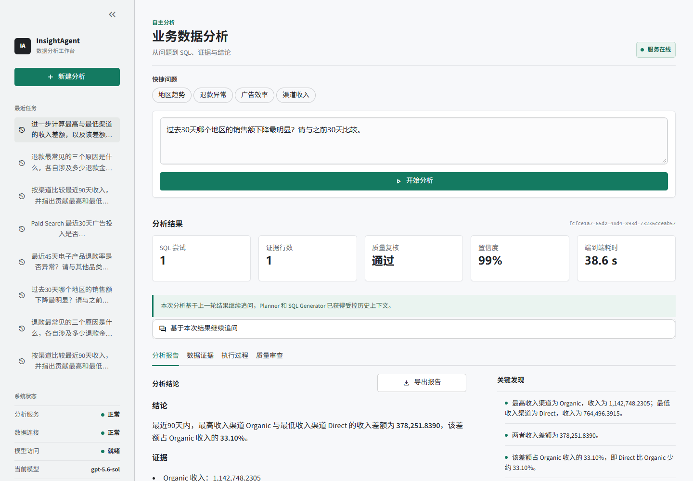
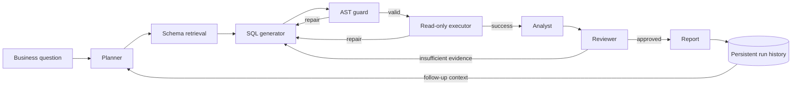

# InsightAgent

[](https://github.com/Miyushen/ai/actions/workflows/ci.yml)

InsightAgent is an autonomous business data analysis agent built with LangGraph. It turns a business question into a plan, generates and validates read-only SQL, executes it against PostgreSQL, analyzes the evidence, asks an independent reviewer to check the conclusion, and produces an inspectable report.

Version 0.2 adds persistent analysis history and evidence-aware follow-up questions. Completed and failed runs survive browser refreshes and container restarts, and any completed report can become controlled context for the next LangGraph run.



For a Chinese presentation script, demo flow, and common interview questions, see [Interview Guide](docs/INTERVIEW_GUIDE.md).

## Architecture



The OpenAI integration follows the official [OpenAI API quickstart](https://platform.openai.com/docs/quickstart): the API key is loaded from an environment variable, excluded from the Docker build context, and never committed to source control.

## Features

- LangGraph state machine with bounded repair loops
- OpenAI structured outputs for plans, SQL, analysis, and review
- PostgreSQL schema introspection instead of hard-coded prompt text
- SQLGlot AST validation and a strict business-table allowlist
- PostgreSQL read-only transactions, statement timeouts, and row limits
- Deterministic ecommerce dataset with several planted business anomalies
- FastAPI backend and Streamlit operations interface
- Execution trace with per-node latency, end-to-end timing, generated SQL, raw evidence, reviewer confidence, and charts
- PostgreSQL-backed run history with report replay, failure records, and parent-child analysis lineage
- Evidence-aware follow-up analysis using bounded prior report, SQL, and result-row context
- Markdown report and CSV evidence export
- Starter evaluation set with completion, review, keyword recall, end-to-end latency, and per-node latency metrics
- Golden-result evaluation backed by deterministic read-only oracle queries

## Quick start

1. Create a local environment file:

   ```powershell
   Copy-Item .env.example .env
   ```

2. Edit `.env` and set your key. Do not paste the key into chat or commit it:

   ```env
   OPENAI_API_KEY=your_key_here
   OPENAI_BASE_URL=https://api.openai.com/v1
   OPENAI_MODEL=gpt-4.1-mini
   OPENAI_USE_RESPONSES_API=true
   ```

   For an OpenAI-compatible provider, set its base URL and an available model name. The
   provider must implement the Responses API and structured outputs used by the workflow.

3. Start the stack:

   ```powershell
   docker compose up --build
   ```

4. Open:

   - Streamlit: <http://localhost:8501>
   - FastAPI docs: <http://localhost:8000/docs>
   - Health check: <http://localhost:8000/api/v1/health>

Key API endpoints:

- `POST /api/v1/analyze` starts an analysis; pass `parent_request_id` for a follow-up.
- `GET /api/v1/runs` lists persisted successful, running, and failed tasks.
- `GET /api/v1/runs/{request_id}` replays a completed analysis result.
- `GET /api/v1/schema` exposes the allowlisted schema, business metrics, and data coverage.

The API container creates and seeds the database on first start. Later starts keep the PostgreSQL volume and skip reseeding.

## Example questions

- 过去30天哪个地区的销售额下降最明显？请给出证据。
- 最近45天电子产品退款率是否异常？主要原因是什么？
- Paid Search 最近30天的广告投入是否带来了匹配的业务增长？
- 按渠道比较最近90天的收入趋势，并指出值得关注的变化。

## Safety model

The SQL safety boundary is enforced in code and in PostgreSQL, not only by prompting:

1. Parse exactly one PostgreSQL statement with SQLGlot.
2. Reject DDL, DML, commands, transactions, and non-SELECT statements.
3. Reject every table outside the business allowlist.
4. Add or clamp a server-side row limit.
5. Execute inside a read-only transaction with a statement timeout.
6. Roll back every analysis transaction after reading the result.

For a production deployment, also use a dedicated PostgreSQL role that has only `CONNECT`, `USAGE`, and `SELECT` privileges.

## Tests and evaluation

Run unit tests in the API image:

```powershell
docker compose run --rm api pytest -q
```

Run the starter end-to-end evaluation after the stack is healthy:

```powershell
docker compose exec api python scripts/run_evals.py
```

Evaluation output is written to `artifacts/eval-results.json`, including per-case node timings, aggregate mean node latency, and golden-result recall computed from deterministic read-only oracle queries.

### Latest local baseline

Measured on 2026-11-09 with `gpt-5.6-sol` through an OpenAI-compatible CC Switch route:

| Metric | Result |
| --- | ---: |
| Evaluation cases | 5 |
| HTTP success rate | 100% |
| Reviewer approval rate | 100% |
| Golden-result score | 100% |
| Golden entity recall | 100% |
| Golden numeric recall | 100% |
| Expected-term recall | 90% |
| Median end-to-end latency | 70.30 s |
| Maximum end-to-end latency | 77.09 s |

All five cases completed successfully; four used one SQL attempt and the highest/lowest channel case used the bounded reviewer repair loop once. Treat this as a small deterministic demo baseline, not a production-quality accuracy claim; the raw per-case evidence is stored in `artifacts/eval-results.json`.

## Project structure

```text
app/agent/       LangGraph state, nodes, structured output schemas
app/api/         FastAPI routes and response models
app/core/        Environment configuration
app/db/          SQLAlchemy models and deterministic seed data
app/services/    Schema retrieval, SQL guard, read-only executor, run history
ui/              Streamlit interface
evals/           Evaluation questions
scripts/         Evaluation runner
tests/           Unit tests
```

## Interview discussion points

- Why a controlled state graph is easier to debug than unrestricted multi-agent chat
- Why SQL security must be enforced at AST, transaction, and database-role layers
- How reviewer feedback is routed into a bounded repair loop
- How to measure task completion, SQL accuracy, tool success, latency, and cost
- How per-node timing separates model latency from deterministic SQL and database work
- How planted anomalies make the demo repeatable without hard-coding conclusions
